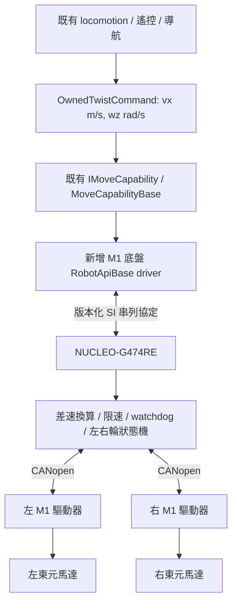

# M1 + 東元 400W 差速 UGV 整合

更新日期：2026-11-25。狀態：已完成協定/差速核心、只讀 SDO 診斷與健康回報，並接入 `main.c`。
已有可建置的 GCC 診斷 ELF/HEX/BIN 與 AGX JSON 監看工具；locomotion driver、運轉狀態機、
實機驗證及 C2 WebSocket 接線尚未完成。詳見 [只讀診斷操作](read-only-diagnostics.md)。

## 硬體基線

| 項目 | 已確認內容 | 待確認內容 |
| --- | --- | --- |
| 車體 | 使用者確認左右輪差速；輪徑 440 mm、左右輪中心距 739 mm、機械減速比 10:1 | 左右安裝方向、有效輪徑與轉彎校正 |
| MCU | 使用者確認 NUCLEO-G474RE | 外接 CAN transceiver、急停與抱閘接線 |
| 驅動器 | 使用者確認創盟 M1，已提供 CANopen Rev.8 協議 | 完整銘牌型號、韌體版本與實機控制模式/PDO/單位讀回 |
| 馬達 | 使用者提供：東元 DTSX06401C4NT3D01，DC48V、400W，最高 4000 rpm | 額定轉速、額定/峰值電流、極對數、編碼器介面與解析度、抱閘規格 |
| 驅動器與馬達匹配 | 尚未確認 | 創盟是否已配置馬達參數、回授與換相並完成試轉 |

馬達型號與 48V/400W 為使用者提供資料，目前未取得該完整型號的原廠規格。
不可由料號自行推定編碼器格式或抱閘；不可用 400W / 48V 取代伺服馬達相電流規格。

## 控制架構



兩個 M1 分別控制左右輪是本設計的配置，實際數量待核對。CAN 路徑以 CAN 型號為前提；
依已提供 M1 規格書，C 型號為 RS485/CAN、E 型號為 EtherCAT，不能僅憑「M1」確認介面。

上層沿用速度命令、motion owner/token 與停止操作。新增獨立硬體型號（建議 `dexmart_m1_ugv`）、
底盤 API、capability、factory/registry 路由與 YAML。新 API 使用 SI identity 單位，
STM32 處理車體到左右輪的換算及驅動器協定。

既有接點：

- `src/core/devices/robot/include/devices/robot/facade/Robot.hpp`
- `src/core/devices/robot/include/devices/robot/capability/IMoveCapability.hpp`
- `src/core/devices/robot/include/devices/robot/capability/MoveCapabilityBase.hpp`
- `src/core/devices/robot/include/devices/robot/api/RobotApiBase.hpp`
- `src/drivers/factory/include/drivers/factory/TopLevelRobotFactory.hpp`

現有 `KuangShinUgv02Api` 的速度倍率、四輪 TPDO4 與啟動/抱閘交換屬於舊設備，
不直接當作 M1 實作。共用傳輸機制可以參考 `UgvSerialBridge.hpp`，但新協定要有版本與明確 SI 單位，
避免舊 `MOVE` 的 command units 被解讀成 m/s。不得假裝 M1 提供舊 PLC safety 或四輪回授。

## STM32 接線與功能邊界

STM32 專案：`D:/stm32/M1CN016RE_Controller`。
現有外設設定：FDCAN1_RX PB8、FDCAN1_TX PB9、Classic CAN 1 Mbps；
COM1 為板上 ST-LINK VCP 對應的 LPUART1 PA2/PA3，另有 USART1 PC4/PC5。
VCP 實際連通性與板上焊橋需核對；目前初始化程式不等於已實作 CANopen master。

```text
上位機 USB -> ST-LINK VCP -> MCU
MCU PB9 TX / PB8 RX -> 3.3V 邏輯相容 CAN transceiver
CANH/CANL 幹線 -> 左 M1 / 右 M1（各自唯一 node ID）
```

若確認使用 M1C，所附規格書 PDF p.3 的 CN6：CANL 23/24、CANH 25/26、
信號 GND 21/22；27/28 為另一組 UART，文件標示 TTL 5V。
MCU CAN TX/RX 必須經 transceiver，不能直接接 CANH/CANL。
幹線兩端各一組 120 Ω，需先確認既有設備終端；不要每節點重複加裝。

M1 STO1/STO2 為 CN6 13/15，文件標示 5–30 VDC。實體急停獨立設計；
STO 去轉矩不等同煞停或坡道抱閘。抱閘電壓、電流、延遲與停車順序仍待實際匹配資料。

## 差速換算

`b` 是左右輪中心距（m），`rL/rR` 是有效輪半徑（m），`gL/gR` 是馬達轉速/輪速的
機械減速比，`sL/sR` 是安裝方向（±1）：

使用者已提供輪徑 440 mm、左右輪中心距 739 mm 與減速比 10，目前依兩側相同輪徑及 10:1 減速理解：
`rL=rR=0.220 m`、`b=0.739 m`、`gL=gR=10`。
`b` 是左右兩側驅動輪中心線的橫向距離，不是前後軸距，也不是輪胎外緣總寬。
名目幾何資料已齊全；有效輪徑、方向及實車轉彎尚未驗證，因此不直接啟用 geometry_verified。

```text
vL = vx - wz*b/2
vR = vx + wz*b/2
motor_rpm_L = sL * vL * 60*gL / (2*pi*rL)
motor_rpm_R = sR * vR * 60*gR / (2*pi*rR)
```

套入本車名目尺寸，在等比例限速之前：

```text
motor_rpm_L = sL * (434.058936*vx - 160.384777*wz)
motor_rpm_R = sR * (434.058936*vx + 160.384777*wz)
```

`vx` 單位 m/s、`wz` 單位 rad/s。例：直行 1 m/s 時兩側馬達轉速幅值約 434.06 rpm；
原地左轉 1 rad/s 時左/右輪等效馬達轉速為 -160.38/+160.38 rpm，再乘各自安裝方向。
這是幾何換算結果，不代表已完成實機速度校正。

前進 `vx>0`、後退 `vx<0`、原地左轉 `vx=0,wz>0`、原地右轉 `vx=0,wz<0`。
任一輪超限時兩輪等比例縮小以保持曲率。幾何與齒比未驗證時禁止 activate。
馬達 rpm 到 CAN 物件值的轉換必須依 M1 文件確認，不假定 `0x60FF` 的單位就是 rpm。
4000 rpm 是馬達軸最高轉速，不是輪速或試車目標。設定上限可低於 4000，但不得超過；
轉為整數 CAN 值時向零取整，避免量化後超出要求的轉速。

## 新通訊手冊核對結果

已核對 `DEXMART CANopen 說明-v8-20260115.pdf` 的相關完整頁面。
這份文件已補足主要協定資訊，可據此寫程式；仍須核對實機韌體支援的 profile。
PDF p.5 列有多個產品家族，p.58 的 M0X 設備名稱只是範例，不能以該範例字串識別所有 M1。

本設計先採用 p.93 的 **Control Mode 5（CiA402 CAN）**，以及 p.106、135-137 的
**6060=3（Profile Velocity）**。不自動改動原廠馬達參數或 EEPROM，不自動重置故障。

| PDO | 標準 CAN ID | CiA402 CAN payload（little endian） |
| --- | --- | --- |
| RPDO1 | `0x200 + node` | `6040` u16、`6060` i8、`607A` i32，共 7 bytes |
| RPDO2 | `0x300 + node` | `60FF` i32、`6081` u32，共 8 bytes |
| RPDO3 | `0x400 + node` | `6083` u32、`6084` u32，共 8 bytes |
| TPDO1 | `0x180 + node` | `6041` u16、`6061` i8、`6064` i32，共 7 bytes |
| TPDO2 | `0x280 + node` | `606C` i32、`60FD` u32，共 8 bytes |

此表依 PDF p.101-102；不能套用 p.98-100 的 EtherCAT mapping，或 MultiCMD 的封包。
啟動前必須讀回實際 mapping 的數量、每個 entry、COB-ID 與觸發方式。

PDF p.107-108 的控制流程可用 `6040=0006 -> 0007 -> 000F` 啟動，
每步仍需讀回 `6041` 的對應狀態，並確認 `6061=3`、remote bit 9；
寫入成功不代表已致能。運轉期間還需要新鮮回授、雙輪互鎖與 timeout，單次 ready 判斷不足。

PDF p.137 明定 `60FF/606C` 為使用者定義速度單位。p.109-113 描述 Factor Group 與 SI metadata：
`608F`、`6091`、`6092`、`6096` 等需要依實際配置核對；p.113 的 mm/s 編碼不能直接視為實機設定。
程式採明確的「CAN raw units / 馬達 rpm」有理數倍率，只有經實機確認才標記 verified。
`6080` 在 p.112 的單位仍寫有兩種可能，不能未核對就直接寫入 4000。

## 已新增程式與驗證邊界

在 `D:/stm32/M1CN016RE_Controller`：

- `Core/Inc/m1_canopen.h`、`Core/Src/m1_canopen.c`：SDO expedited、NMT、SYNC、
  CiA402 CAN PDO、mapping 比對、狀態解析、驗證過的單位換算及差速換算。
- `tests/m1_canopen_test.c`、`tests/CMakeLists.txt`：封包格式、負數、錯誤/不相符 SDO、
  mapping、狀態遮罩、單位倍率、4000 rpm 上限、輪型參數及等比例限速測試。
- `README.md`：編譯方式、協定前提與待整合項目。

native CTest、AddressSanitizer/UndefinedBehaviorSanitizer 與 Cortex-M4 GCC 編譯已驗證。
codec 函式本身不會送 CAN；新增的只讀診斷 runtime 可由 console 啟動 SDO upload，
可持續回報左右驅動器的健康、fault/warning、失聯、模式及資料新鮮度。
已加入 EWARM target 與 `main.c`，另提供 GCC 完整建置及只讀 image 檢查；
尚未燒錄、試轉、驗證 IAR build 或進行硬體在環測試。
`motion_allowed` 在此診斷版本固定為 0，raw PDO 組包函式仍不替代運轉授權與安全狀態機。

## 協定與故障契約

- 握手核對版本、單位、拓樸、韌體/profile 與 boot/session ID；不相容時禁止啟動。
- 嚴格驗證序號、校驗、欄位數、長度與有限數值；不支援的軸在 SI 轉換裁切前拒絕。
- ACTIVATE 只在左右驅動器狀態讀回正確、零目標與配置驗證後回 ready。
- HOLD、DISABLE、ESTOP 使用對應 token/session 回覆；區分 CAN 已提交、設備已確認與實測靜止。
- STM32 獨立監控 host 命令失聯；CAN keepalive 與查詢不能延長舊非零命令。
- 驅動器另設通訊 timeout，以涵蓋 MCU 當機/斷線後無法送停止的情況。
- 任一輪故障、bus-off、回授過期時停止雙輪並清除待執行速度；恢復後需重新啟動與新命令。
- 只有真實、有效且新鮮的左右輪回授可以形成 odometry；不得以命令速度冒充實測值。

## 接入實機尚需確認

1. M1 完整型號、韌體版本，以及該實機的控制模式、PDO mapping、速度/位置單位、
   啟動/停止與 heartbeat/通訊 timeout 設定。Rev.8 已提供協定，EDS 可協助交叉核對，
   不再把「沒有完整手冊」當作無法開發的前提。
2. DTSX06401C4NT3D01 的回授/動力/抱閘接腳與馬達參數，以及 M1 配套參數或成功試轉紀錄。
3. 左右安裝方向、有效輪徑與轉彎校正；已取得輪徑 440 mm、左右輪中心距 739 mm、機械減速比 10:1。
   未定案項目保留為必填設定，不使用舊 UGV 的數值補入。

優先驗證馬達匹配，再做不致能 identity/status 讀取、架空低速單輪、雙輪方向、失聯/故障/急停，
最後落地校正與導航。驅動器端失聯保護還需核對適用的參數與實測停止行為。
JSDT 手冊不代替 M1 的控制協定。

## 資料依據

- 使用者於 2026-11-25 提供的硬體配置與馬達型號。
- 使用者補充：馬達最高轉速 4000 rpm。
- 使用者補充：輪徑 440 mm、減速比 10（依 10:1 減速理解）、左右驅動輪中心距 739 mm。
- `D:/合作商資料/廣欣/2nd-UGV/創盟/DEXMART CANopen 說明-v8-20260115.pdf`，Rev.8，
  PDF p.9-18、32-35、58-64、90-113、135-137。
- `D:/合作商資料/廣欣/2nd-UGV/創盟/M1-SpecSheet_SS-01-S0647_20260827.pdf`（前一輪已核對 PDF p.1、3）。
- 既有 codebase 與 STM32 專案。
- 原廠公開支援頁：https://www.dexmart.com.tw/support 。先前公開檢索未取得可核對該 M1 版本的 EDS 或馬達配套參數。
